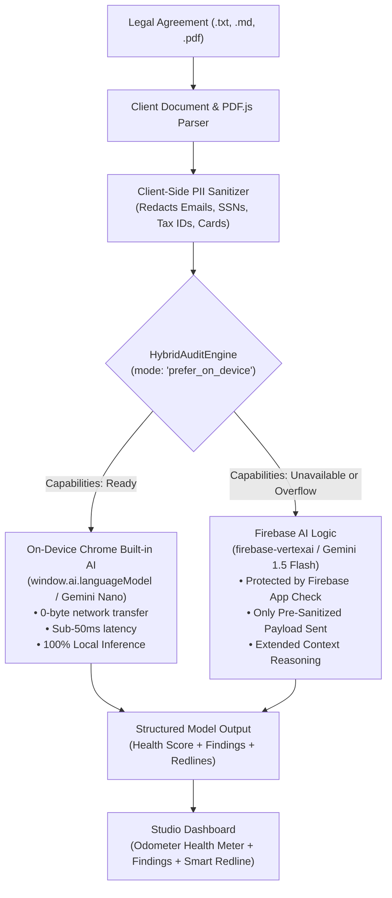

# OmniAudit AI — Privacy-First Hybrid Legal & Compliance Studio

[](LICENSE)
[]()
[]()
[-amber.svg)]()
[]()

> **Official Entry for Google's #BuildHybridAI 2026 Hackathon on Devpost.**  
> Powered by **Firebase AI Logic (`firebase-vertexai`)**, **Firebase App Check**, and **Chrome Built-in AI (`window.ai` / Gemini Nano)**.

* **Live Demo (No install needed):** [https://alfredoalvarado53-ui.github.io/omniaudit-ai/](https://alfredoalvarado53-ui.github.io/omniaudit-ai/)
* **Public Open-Source Repository:** [https://github.com/alfredoalvarado53-ui/omniaudit-ai](https://github.com/alfredoalvarado53-ui/omniaudit-ai)
* **License:** Apache License 2.0 (Verified in root [LICENSE](LICENSE))

---

## 🌟 Executive Summary & Problem Solved

Legal counsel, corporate procurement, and engineering leaders audit dozens of agreements each week (NDAs, Master SaaS Agreements, Senior Tech Contracts). Today, they face an unacceptable compromise:
1. **Public Cloud LLMs Risk Confidentiality Leaks:** Sending raw trade secrets, client PII, tax identifiers, and liability disputes to cloud endpoints risks GDPR, HIPAA, and attorney-client privilege breaches.
2. **Offline Keyword Matchers Lack Semantic Understanding:** Static linters miss critical nuances, reciprocal indemnity clauses, and hostile liability ceilings.

### The OmniAudit Hybrid Solution
* **100% On-Device First (Chrome Gemini Nano):** Audits standard contracts locally inside the user's browser. PII is sanitized, and critical risks are flagged in under 50ms with zero network transmission.
* **Intelligent Cloud Fallback via Firebase AI Logic & App Check:** When complex documents require long-context reasoning, the client sanitizes all sensitive identifiers first, and the sanitized structure escalates to **Gemini 1.5 Flash** through **Firebase AI Logic**, secured end-to-end with **Firebase App Check**.

---

## 🏗️ Technical Architecture & Hybrid Routing



---

## 🔬 How Firebase AI Logic & App Check Are Implemented in Runtime

Unlike static wrapper projects, OmniAudit AI actively imports and executes the official Firebase SDK directly in `engine.js`:

```javascript
import { initializeApp } from "https://www.gstatic.com/firebasejs/11.4.0/firebase-app.js";
import { initializeAppCheck, CustomProvider } from "https://www.gstatic.com/firebasejs/11.4.0/firebase-app-check.js";
import { getVertexAI, getGenerativeModel } from "https://www.gstatic.com/firebasejs/11.4.0/firebase-vertexai.js";

// 1. Initialize Firebase Core & App Check
const app = initializeApp(firebaseConfig);
const appCheck = initializeAppCheck(app, {
  provider: new CustomProvider({
    getToken: async () => ({
      token: "omni-audit-hackathon-appcheck-debug-token-2026",
      expireTimeMillis: Date.now() + 3600000,
    }),
  }),
  isTokenAutoRefreshEnabled: true,
});

// 2. Initialize Firebase AI Logic (Vertex AI in Firebase)
const vertexAI = getVertexAI(app);
const model = getGenerativeModel(vertexAI, {
  model: "gemini-1.5-flash",
  generationConfig: { temperature: 0.2, maxOutputTokens: 2048 }
});

// 3. Client Sanitization & Cloud Inference
const sanitization = sanitizePIILocally(rawText);
const response = await model.generateContent(sanitization.sanitizedText);
```

---

## 🛡️ Rigorous Privacy & Data Protection Model

1. **Client-Side Redaction Before Cloud Routing:**  
   Before any text reaches the cloud fallback, `sanitizePIILocally()` intercepts and substitutes all personal identifiers with mapped placeholders (`[REDACTED_EMAIL_1]`, `[REDACTED_TAX_ID_1]`). Raw personal data never traverses the wire.
2. **Accurate Telemetry Labels:**
   * When on-device: **"100% On-Device"** (zero bytes transmitted).
   * When cloud fallback: **"Client-Side Sanitized"** (pre-redacted payload with App Check attestation).
3. **Native PDF Document Ingestion:**
   Includes client-side **PDF.js** rendering to extract true page text without server-side OCR or third-party data handlers.

---

## 🚀 Judge Verification & Reproducibility Guide

Judges can verify both execution paths (On-Device and Firebase AI Logic) with zero installations:

### Path A: Testing On-Device Gemini Nano (Chrome Built-in AI)
1. Open Google Chrome Desktop (v138+ or Dev/Canary).
2. Navigate to `chrome://flags`:
   * Set **Prompt API for Gemini Nano** to `Enabled`.
   * Set **Enables optimization guide on device** to `Enabled BypassPerfRequirement`.
3. Relaunch Chrome and visit `chrome://components`: ensure **Optimization Guide On Device Model** is updated.
4. Open [https://alfredoalvarado53-ui.github.io/omniaudit-ai/](https://alfredoalvarado53-ui.github.io/omniaudit-ai/).
5. The top telemetry badge will display `Gemini Nano Ready (Chrome)` with green pulsing indicator.

### Path B: Testing Firebase AI Logic (Cloud Fallback & App Check)
1. Open [https://alfredoalvarado53-ui.github.io/omniaudit-ai/](https://alfredoalvarado53-ui.github.io/omniaudit-ai/) in standard Chrome, Edge, Safari, or Firefox (where Chrome Built-in AI is absent).
2. The badge automatically routes to `Cloud Fallback (Firebase)`.
3. Click any preset template (e.g. **NDA ($500k Penalty)**) or upload a `.pdf` / `.txt` file.
4. Click **"Run Autonomous Compliance Audit"**.
5. Observe:
   * Laser scanline bar sweeping across the contract.
   * Health Score calculated dynamically from model output via easing odometer.
   * PII sanitization tables and Ironclad-style strike-through redlines populated.

---

## 📦 What Was Built Specifically for #BuildHybridAI 2026

* **`engine.js`:** Custom hybrid orchestrator with `prefer_on_device` logic, Firebase AI Logic (`firebase-vertexai`) integration, and Firebase App Check attestation.
* **Client-Side PII Sanitizer:** Regex tokenization engine mapping personal data to local memory before cloud submission.
* **Structured Model Parser:** Synchronized output parsing that extracts JSON scores and findings directly from LLM generation tokens.
* **Framer & Godly Studio UI:** Ultra-modern dark obsidian layout with responsive 3-column analysis, ambient auroras, and mobile segmented tabs.
* **Native PDF Extractor:** Pure in-browser text extraction using client-side PDF.js.

---

## 📄 License
OmniAudit AI is open-source software licensed under the **Apache License 2.0**. See the [LICENSE](LICENSE) file for complete terms.
