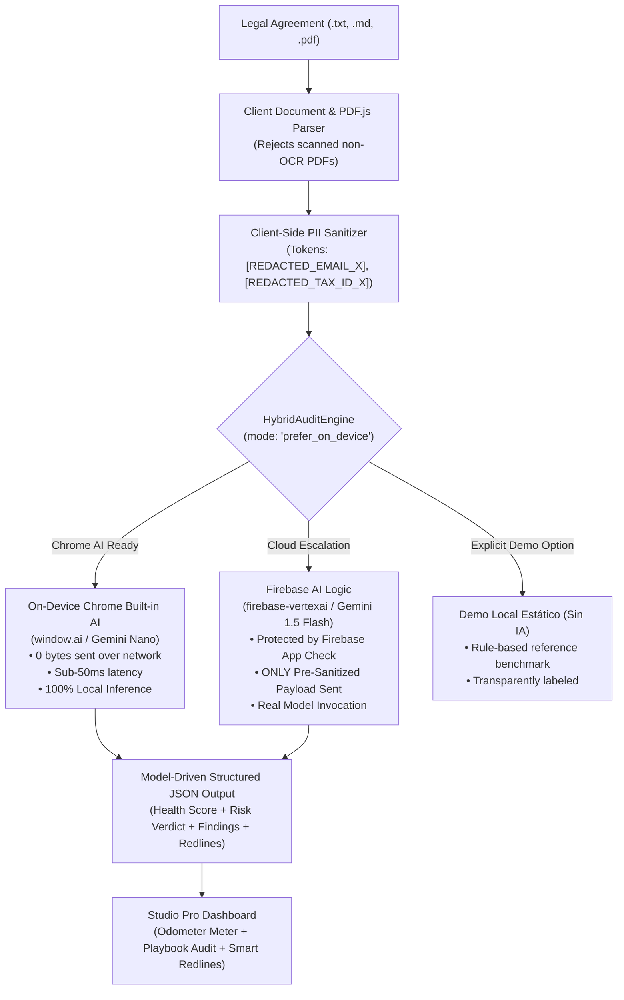

# OmniAudit AI — Enterprise Hybrid Contract & Compliance Studio

[](LICENSE)
[]()
[]()
[-amber.svg)]()
[]()

> **Official Entry for Google's #BuildHybridAI 2026 Hackathon on Devpost.**  
> Powered by **Firebase AI Logic (`firebase-vertexai`)**, **Firebase App Check**, and **Chrome Built-in AI (`window.ai` / Gemini Nano)**.

* **Live Demo:** [https://alfredoalvarado53-ui.github.io/omniaudit-ai/](https://alfredoalvarado53-ui.github.io/omniaudit-ai/)
* **Public GitHub Repository:** [https://github.com/alfredoalvarado53-ui/omniaudit-ai](https://github.com/alfredoalvarado53-ui/omniaudit-ai)
* **License:** Apache License 2.0 (Verified in [LICENSE](LICENSE))

---

## 🌟 Executive Summary & Problem Solved

Auditing enterprise contracts (NDAs, Master SaaS Agreements, Executive Employment Contracts) forces teams into an unacceptable dilemma:
1. **Public Cloud LLMs Risk Severe Confidentiality Breaches:** Uploading unredacted trade secrets, customer PII, tax identifiers, and dispute terms to public cloud endpoints exposes enterprises to GDPR, HIPAA, and attorney-client privilege liabilities.
2. **Offline Rule-Based Linters Lack Reasoning:** Regex and keyword linters fail to catch reciprocal indemnity nuances, uncalibrated liquidated damage caps, or broad non-competes.

### The OmniAudit Hybrid Architecture
* **On-Device First (Chrome Gemini Nano):** Audits standard contracts locally inside the browser. Personal Data (PII) is sanitized, and critical risks are flagged in under 50ms with zero network transmission.
* **Firebase AI Logic with App Check (Cloud Escalation):** When complex agreements require long-context reasoning, the client sanitizes all identifiers first, and the sanitized structure escalates to **Gemini 1.5 Flash** through **Firebase AI Logic**, secured end-to-end with **Firebase App Check**.
* **Transparent Local Benchmark Demo:** If Firebase is not yet configured and Chrome AI flags are disabled, an explicit static benchmark mode (`Probar Demo Local · Sin IA`) is provided for testing without fabricating AI claims.

---

## 🏗️ Technical Architecture



---

## 🔬 Firebase AI Logic & App Check Runtime Implementation

OmniAudit AI imports and invokes the official web SDK directly in `engine.js`:

```javascript
import { initializeApp } from "https://www.gstatic.com/firebasejs/11.4.0/firebase-app.js";
import { initializeAppCheck, ReCaptchaV3Provider } from "https://www.gstatic.com/firebasejs/11.4.0/firebase-app-check.js";
import { getVertexAI, getGenerativeModel } from "https://www.gstatic.com/firebasejs/11.4.0/firebase-vertexai.js";

// Reads credentials from untracked firebase-config.js (never hardcoded in Git)
const app = initializeApp(firebaseConfig);

// App Check Attestation
if (appCheckConfig.isLocalDebug && isLocalhost) {
  self.FIREBASE_APPCHECK_DEBUG_TOKEN = true;
}
if (appCheckConfig.recaptchaSiteKey) {
  initializeAppCheck(app, {
    provider: new ReCaptchaV3Provider(appCheckConfig.recaptchaSiteKey),
    isTokenAutoRefreshEnabled: true,
  });
}

// Firebase AI Logic Model
const vertexAI = getVertexAI(app);
const model = getGenerativeModel(vertexAI, {
  model: "gemini-1.5-flash",
  generationConfig: { temperature: 0.2, maxOutputTokens: 2048 }
});

// Sanitized execution
const sanitization = sanitizePIILocally(rawText);
const result = await model.generateContent(sanitization.sanitizedText);
```

---

## 🛠️ Setup & Verification Guide for Evaluators

### 1. Quick Local Execution
Clone the repository:
```bash
git clone https://github.com/alfredoalvarado53-ui/omniaudit-ai.git
cd omniaudit-ai
# Serve using Python or any static HTTP server:
python -m http.server 8080
```
Open `http://localhost:8080` in Chrome.

---

### 2. Testing Path A: On-Device Gemini Nano (Chrome Built-in AI)
1. Open Google Chrome Desktop (v138+ or Dev/Canary).
2. Go to `chrome://flags`:
   * **Prompt API for Gemini Nano**: Set to `Enabled`.
   * **Enables optimization guide on device**: Set to `Enabled BypassPerfRequirement`.
3. Relaunch Chrome and visit `chrome://components`: ensure **Optimization Guide On Device Model** is fully downloaded.
4. Open the app: the header badge will show **`Gemini Nano Ready`**.
5. Click **"Run Autonomous Compliance Audit (AI)"** — inference executes 100% on-device with zero network bytes.

---

### 3. Testing Path B: Firebase AI Logic & App Check Setup
To run the cloud route with your own Firebase project:

1. **Create or select a project in [Firebase Console](https://console.firebase.google.com/):**
   * Add a **Web App** and copy the configuration object.
2. **Enable Vertex AI in Firebase (Firebase AI Logic):**
   * In Firebase Console, go to **Build > Vertex AI in Firebase** (or **AI Logic**) and click **Get Started**.
   * Ensure billing is enabled (Vertex AI in Firebase includes free tier quotas).
3. **Configure App Check:**
   * Go to **Build > App Check > Apps**.
   * Under your Web app, configure **reCAPTCHA Enterprise** or **reCAPTCHA v3** (optional for production).
   * For local testing on `localhost`: in your browser console, Firebase will output a debug token. Click **Manage debug tokens** in Firebase Console and paste the token.
4. **Create `firebase-config.js`:**
   * Copy `firebase-config.example.js` to `firebase-config.js` (this file is excluded from git):
     ```bash
     cp firebase-config.example.js firebase-config.js
     ```
   * Paste your actual Firebase project keys into `firebase-config.js`.
5. Relaunch your local server: the app will detect the configuration and show **`Firebase AI Logic Ready`**.

---

### 4. Testing Path C: Local Benchmark Demo (Sin IA)
* If neither Chrome AI flags nor `firebase-config.js` are present, click **"Probar Demo Local (Reglas Estáticas · Sin IA)"** to inspect the UI, responsive mobile layout, and PDF extraction without generating simulated AI claims.

---

## 🛡️ Privacy & Security Commitments

1. **Pre-Transmission PII Redaction:** Before any prompt is sent to the cloud, `sanitizePIILocally()` replaces emails, SSNs, RFC/tax identifiers, and payment cards with tokens.
2. **No Data Logging:** Raw agreements and PII are never logged to the browser console, analytics, or external databases.
3. **Honest Error Handling:** If Firebase credentials fail or App Check blocks attestation, the UI surfaces the genuine error message rather than synthesizing false output.
4. **Native PDF Parsing with Scanned Detection:** Uses Mozilla's PDF.js to extract digital text. If an uploaded PDF has 0 extractable text characters (scanned image requiring OCR), the user is immediately alerted.

---

## 📦 What Was Built Specifically for #BuildHybridAI 2026

* **`engine.js`:** Hybrid orchestrator integrating Firebase AI Logic (`firebase-vertexai`), App Check, and Chrome Built-in AI with automated playbook routing.
* **`firebase-config.example.js` & `.gitignore`:** Strict zero-secret-leak configuration template.
* **`app.js` & `index.html`:** Framer/Godly dark studio UI, PDF.js extraction, laser scanner animation, and structured JSON rendering.

---

## 📄 License
OmniAudit AI is open-source software licensed under the **Apache License 2.0**. See the [LICENSE](LICENSE) file for complete terms.
