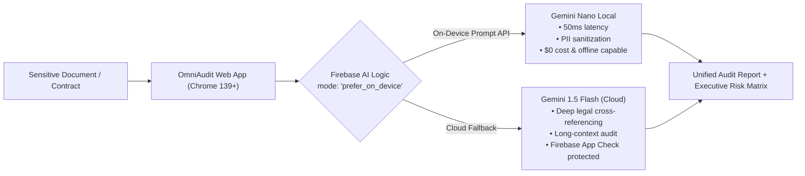

# OmniAudit AI — Privacy-First Hybrid Document & Compliance Auditor

[](LICENSE)
[]()
[]()

> **Built for the official Google #BuildHybridAI 2026 Hackathon on Devpost.**  
> Powered by **Firebase AI Logic** with Hybrid On-Device Inference (`prefer_on_device` via Chrome's Built-in **Gemini Nano** + automatic cloud fallback to **Gemini 1.5 Flash**).

---

## 🌟 Overview & Value Proposition

Auditing contracts, financial records, medical transcripts, or technical specifications usually forces developers and enterprises to make an unacceptable trade-off:
* **Upload sensitive data to public cloud APIs**, risking privacy breaches (GDPR, HIPAA, attorney-client privilege).
* **Rely on dumb regex rules offline**, losing the nuance of real LLM reasoning.

**OmniAudit AI solves this dilemma through Hybrid AI:**
1. **On-Device First (Zero Latency, Zero Cost, 100% Privacy):**  
   Chrome's local **Gemini Nano** runs right inside the browser to sanitize Personally Identifiable Information (PII), detect red-flag clauses, and compute instant risk scores — without sending a single byte over the wire.
2. **Intelligent Cloud Fallback via Firebase AI Logic:**  
   When complex multi-page legal cross-references or long documents require broader reasoning, the cleaned, sanitized structure escalates to **Gemini 1.5 Flash** in the cloud through Firebase AI Logic, secured with **Firebase App Check**.

---

## 🏗️ Technical Architecture



---

## 🚀 Key Features

* **Real-Time Hybrid Badge:** Clear visual indicator showing whether the inference was computed **100% On-Device (Gemini Nano)** or via **Cloud Fallback (Gemini Flash)** with measured latency in milliseconds.
* **Instant PII Sanitizer:** Automatically redacts names, identity numbers, credit cards, and addresses locally before any optional cloud escalation.
* **Legal & Compliance Risk Matrix:** Categorizes clauses into High, Medium, and Low risk with actionable remediation suggestions.
* **Executive Summary Generator:** Produces exportable audit reports (Markdown / PDF / Text).
* **Fully Compliant with Hackathon Rules:** Built on modern Web standards, utilizes official Firebase AI Logic APIs, includes Apache 2.0 license, and ready for deployment on Firebase Hosting.

---

## 💻 Tech Stack

* **Frontend:** Modern Vanilla ES6+ Modules, HTML5, Tailwind CSS (Zero heavy bundler overhead, instant browser execution).
* **Local Inference:** Chrome Built-in AI (`window.ai` / Prompt API via Gemini Nano).
* **Cloud & Hybrid Orchestration:** **Firebase AI Logic SDK** (`@firebase/ai-logic` or Google AI Backend).
* **Security:** **Firebase App Check** (debug token supported for local judge testing).
* **Hosting:** Firebase Hosting (`https://omniaudit-ai.web.app`).

---

## 🛠️ Getting Started (Local Development & Testing)

### Prerequisites
1. **Google Chrome Desktop (v139+)**
2. Enable on-device AI flags:
   * Open `chrome://flags`
   * Enable **Prompt API for Gemini Nano**
   * Enable **Enables optimization guide on device**
3. Verify model status in `chrome://components` (`Optimization Guide On Device Model`).

### Running the App
Clone the repository and serve the static files:
```bash
git clone https://github.com/alfredoalvarado53-ui/omniaudit-ai.git
cd omniaudit-ai
# Open index.html directly in Chrome, or serve with any local HTTP server:
python -m http.server 8080
```
Navigate to `http://localhost:8080` in your Chrome browser.

---

## 📄 License
This project is licensed under the Apache License 2.0 — see the [LICENSE](LICENSE) file for details.
