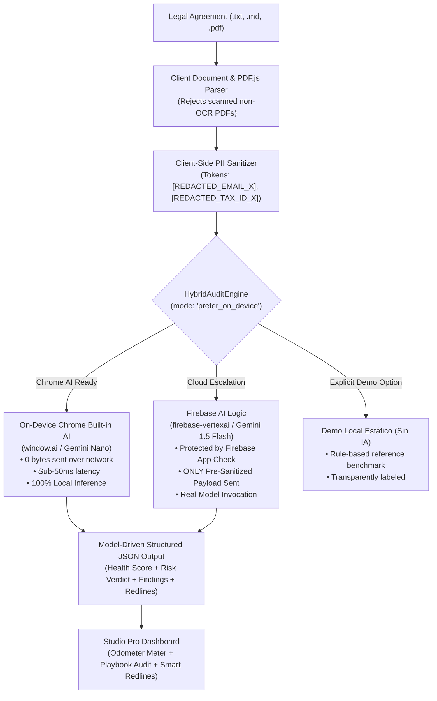

# OmniAudit AI — Enterprise Hybrid Contract & Compliance Studio

[](LICENSE)
[]()
[]()
[-amber.svg)]()
[]()

> **Official Entry for Google's #BuildHybridAI 2026 Hackathon on Devpost.**  
> Powered by **Firebase AI Logic (`firebase-vertexai`)**, **Firebase App Check**, and **Chrome Built-in AI (`window.ai` / Gemini Nano)**.

* **Live Demo (Published on GitHub Pages):** [https://alfredoalvarado53-ui.github.io/omniaudit-ai/](https://alfredoalvarado53-ui.github.io/omniaudit-ai/)
* **Public Open-Source Repository:** [https://github.com/alfredoalvarado53-ui/omniaudit-ai](https://github.com/alfredoalvarado53-ui/omniaudit-ai)
* **License:** Apache License 2.0 (Verified in root [LICENSE](LICENSE))

---

## 🌟 What Was Built for #BuildHybridAI 2026

OmniAudit AI was built from the ground up for the Google **#BuildHybridAI 2026** Hackathon to solve enterprise legal and compliance auditing through true hybrid inference:

1. **`engine.js` (Hybrid Orchestrator):** Implements `prefer_on_device` routing between on-device Chrome Built-in AI (**Gemini Nano**) and cloud escalation via **Firebase AI Logic** (**Gemini 1.5 Flash**), protected by **Firebase App Check**.
2. **Client-Side In-Memory PII Sanitizer:** Intercepts and tokenizes personal emails, tax identifiers (SSN, RFC, CURP), payment card numbers, and phone numbers before any text can be transmitted to the cloud. Raw PII is never sent across the network or logged.
3. **Structured Model-Driven Output:** Instructs models to output validated JSON (`healthScore`, `riskVerdict`, `findings`, `redlines`) alongside an executive Markdown report. The UI renders directly from the model's structured tokens.
4. **Playbook Awareness:** Injects specific enterprise compliance rules into the model prompt according to the active playbook selector (**Standard NDA**, **Enterprise SaaS MSA**, **Senior Tech Employment**, or **Vendor Procurement**).
5. **Native PDF Document Ingestion:** Uses client-side **PDF.js** to parse digital text page-by-page. Automatically detects scanned image PDFs that require OCR and prompts the user accordingly.
6. **Framer & Godly Studio UI:** Ultra-modern dark obsidian layout with responsive 3-column analysis on desktop, segmented touch controls on mobile, ambient floating auroras, and DOMPurify XSS sanitization.
7. **Automated CI/CD Workflow (`.github/workflows/deploy.yml`):** Automatically injects public Firebase configuration from GitHub Secrets / Variables during deployment without committing credentials to version control.

---

## 🏗️ Technical Architecture & Runtime Flow



---

## 🔬 Firebase AI Logic & App Check Runtime Implementation

OmniAudit AI imports and invokes the official web SDK directly in `engine.js`:

```javascript
import { initializeApp } from "https://www.gstatic.com/firebasejs/11.4.0/firebase-app.js";
import { initializeAppCheck, ReCaptchaV3Provider } from "https://www.gstatic.com/firebasejs/11.4.0/firebase-app-check.js";
import { getVertexAI, getGenerativeModel } from "https://www.gstatic.com/firebasejs/11.4.0/firebase-vertexai.js";

// Reads credentials from untracked firebase-config.js, GitHub Actions build, or browser sessionStorage
const app = initializeApp(firebaseConfig);

// Initialize App Check prior to calling AI Logic
if (appCheckConfig.isLocalDebug && isLocalhost) {
  self.FIREBASE_APPCHECK_DEBUG_TOKEN = true;
}
if (appCheckConfig.recaptchaSiteKey) {
  initializeAppCheck(app, {
    provider: new ReCaptchaV3Provider(appCheckConfig.recaptchaSiteKey),
    isTokenAutoRefreshEnabled: true,
  });
}

// Initialize Firebase AI Logic (Vertex AI in Firebase)
const vertexAI = getVertexAI(app);
const model = getGenerativeModel(vertexAI, {
  model: "gemini-1.5-flash",
  generationConfig: { temperature: 0.2, maxOutputTokens: 2048 }
});

// Sanitized execution: ONLY client-redacted text is sent
const sanitization = sanitizePIILocally(rawText);
const prompt = `${systemPrompt}\n\nDocument to audit (Pre-sanitized on client):\n${sanitization.sanitizedText}`;
const response = await model.generateContent(prompt);
```

---

## 🛠️ Step-by-Step Evaluator & Configuration Guide

### Option 1: Instant In-Browser Evaluation (Live on GitHub Pages)
If you want to test the live hosted URL at [https://alfredoalvarado53-ui.github.io/omniaudit-ai/](https://alfredoalvarado53-ui.github.io/omniaudit-ai/) with your own Firebase project:
1. Open the URL in any modern browser.
2. Click the **⚙️ Settings icon** in the top navigation bar.
3. Paste your Firebase Web Config object (e.g., from Firebase Console > Project Settings > Your Apps).
4. *(Optional)* Paste your reCAPTCHA v3 or Enterprise Site Key if you enabled App Check on your domain.
5. Click **"Guardar en Sesión y Recargar"**. Credentials are saved **strictly in your browser's local `sessionStorage`** and are never shared.
6. Click **"Run Autonomous Compliance Audit (AI)"** to invoke Gemini 1.5 Flash live.

---

### Option 2: Configuring Firebase Console & GitHub Actions Deployment

If you are deploying your own fork of OmniAudit AI:

#### 1. In Firebase Console:
1. Create or open a project at [Firebase Console](https://console.firebase.google.com/).
2. Add a **Web App** (`</>`) and copy the configuration snippet.
3. Enable **Vertex AI in Firebase (Firebase AI Logic)**:
   * Go to **Build > Vertex AI in Firebase** and click **Get Started**.
   * Ensure billing is enabled (Vertex AI includes free tier allowances).
4. Configure **Firebase App Check**:
   * Go to **Build > App Check > Apps**.
   * Register your domain (e.g. `your-username.github.io`).
   * Select **reCAPTCHA Enterprise** or **reCAPTCHA v3** and obtain your public Site Key.

#### 2. In GitHub Repository Settings:
Go to **Settings > Secrets and variables > Actions**:
* Add Repository Variables/Secrets:
  * `FIREBASE_API_KEY`: Your Firebase Web API Key (public web identifier).
  * `FIREBASE_PROJECT_ID`: Your Firebase project ID.
  * `FIREBASE_AUTH_DOMAIN`: `your-project-id.firebaseapp.com`.
  * `FIREBASE_STORAGE_BUCKET`: `your-project-id.firebasestorage.app`.
  * `FIREBASE_MESSAGING_SENDER_ID`: Your sender ID.
  * `FIREBASE_APP_ID`: Your web app ID.
  * `RECAPTCHA_SITE_KEY`: (Optional) Public site key for reCAPTCHA App Check.
* On the next push to `main` (or via **Actions > Deploy OmniAudit AI > Run workflow**), GitHub Actions automatically generates `firebase-config.js` and publishes it to GitHub Pages.

> **Security Note:** Firebase Web configuration keys (`apiKey`, `appId`, `projectId`) are public client identifiers designed to be embedded in frontends; security and access control are enforced by **Firebase App Check** and Google Cloud IAM rules. Never commit private service account JSON keys or backend secrets to the frontend.

---

### Option 3: Testing On-Device Gemini Nano (Chrome Desktop)
1. Open Google Chrome Desktop (v138+ or Dev/Canary).
2. Go to `chrome://flags`:
   * **Prompt API for Gemini Nano**: Set to `Enabled`.
   * **Enables optimization guide on device**: Set to `Enabled BypassPerfRequirement`.
3. Relaunch Chrome and visit `chrome://components`: ensure **Optimization Guide On Device Model** is updated.
4. Open the app: the header badge will show **`Gemini Nano Ready`**.
5. Click **"Run Autonomous Compliance Audit (AI)"** — inference executes 100% on-device with zero network bytes.

---

### Option 4: Testing the Local Benchmark Demo (Sin IA)
* If neither Chrome AI flags nor Firebase configuration are present, click **"Probar Demo Local (Reglas Estáticas · Sin IA)"** to evaluate the UI, responsive mobile layout, and PDF extraction without generating simulated AI claims. The report and badge clearly state: *"Aviso de transparencia: Este reporte fue generado mediante el evaluador de referencia estático local sin IA"*.

---

## 🔍 How to Distinguish Between Engines in OmniAudit AI

| Engine / Route | Header Badge | Telemetry Engine Label | Telemetry Privacy Label | Data Sent Over Network |
| :--- | :--- | :--- | :--- | :--- |
| **Chrome Built-in AI** | `Gemini Nano Ready` (Green) | `Gemini Nano (Local)` | `100% On-Device` | **0 Bytes** (100% on NPU/GPU) |
| **Firebase AI Logic** | `Firebase AI Logic Ready` (Cyan) | `Gemini 1.5 Flash (Cloud)` | `Client-Side Sanitized` | Sanitized text only (PII stripped) |
| **Local Benchmark Demo** | `Demo / Requiere Config` (Zinc) | `Demo Local (Sin IA)` | `Demo Local` | **0 Bytes** (Client-side heuristic) |

---

## ⚠️ Known Limitations

1. **Unstructured PII Nuance:** The local client sanitizer uses comprehensive regex for emails, phone numbers, tax IDs (SSN, RFC, CURP), and credit card patterns. Unconventional or non-standard personal identifiers written in colloquial language (e.g., *"My nickname is Bob and I live next to the red barn"*) require LLM-level semantic comprehension and may not be caught by initial client-side regex tokenization.
2. **Scanned PDF Documents:** The built-in PDF reader uses Mozilla's PDF.js to extract digital text streams. Scanned PDFs containing only raster images without an embedded OCR text layer will trigger an explicit error alerting the user that OCR is required.
3. **App Check on Unregistered Custom Domains:** If deployed to a domain not registered under App Check in the Firebase Console, App Check will reject requests with a 403 status. The UI catches and surfaces this exact error clearly.

---

## 🎥 YouTube Demo Video

* **Video Submission Status:** ⏳ **Pending Video Upload**  
  *(A 1–2 minute screen capture demonstration is being finalized with the natural neural voiceover asset located at `omniaudit_voiceover_natural.mp3`).*

---

## 📄 License
OmniAudit AI is open-source software licensed under the **Apache License 2.0**. See the [LICENSE](LICENSE) file for complete terms.
